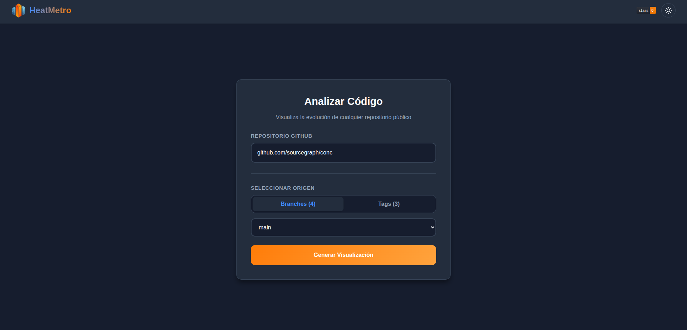
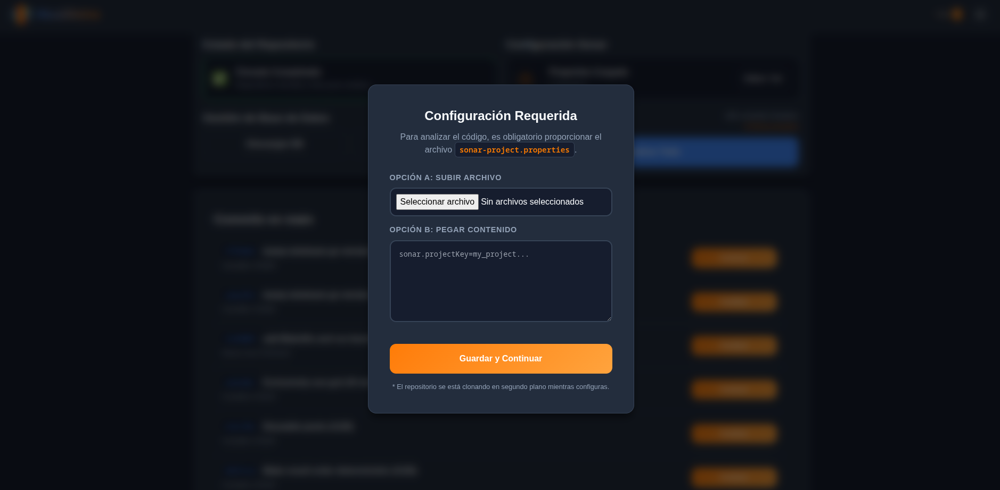
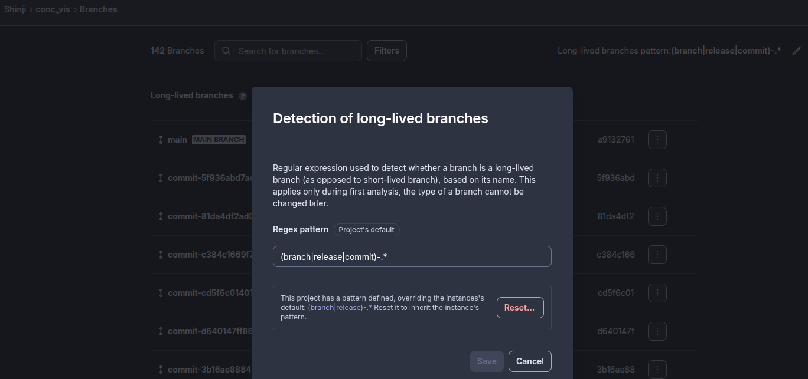
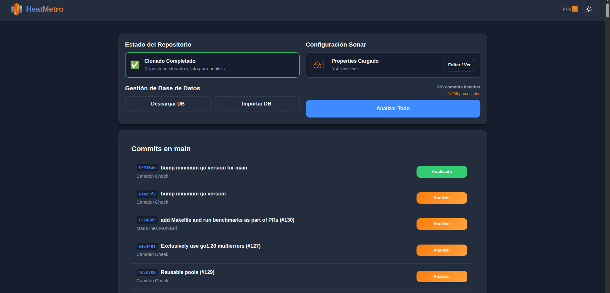

# HeatMetro: Builder

**HeatMetro: Builder** is an automated code analysis platform designed using a microservices architecture. Its primary purpose is to visualize software quality metrics—specifically Halstead metrics, Code Churn, Cyclomatic Complexity, and Cohesion—extracted from GitHub repositories through heatmaps and evolutionary charts.

The system orchestrates repository cloning, static analysis for various languages (Go, JS, TS), and metric persistence by utilizing **Docker** containerization and **Nginx** as a reverse proxy.


## Prerequisites

Ensure the following software is installed on the host system:

- **Docker** (version 20.10 or higher)
- **Docker Compose** (version 2.0 or higher)

## Initial Configuration

Before executing the project, it is mandatory to configure the access credentials via environment variables.

1. Create a file named `.env` in the root directory of the project (at the same level as `docker-compose.yml`).
2. Insert the following content, replacing the placeholder values with valid tokens:

```ini
# .env

# Personal GitHub Token (Classic Token) with repository read permissions (scope: repo)
GITHUB_TOKEN=ghp_your_personal_github_token_here

# SonarCloud Token (used for internal validations)
SONAR_TOKEN=your_sonar_token_here

```

> **Note:** The system will not function without these tokens, as they are required to authenticate with the GitHub API and authorize the analysis processes.

## Execution Instructions

Once the `.env` file is configured, follow these steps to deploy the infrastructure:

### 1. Start Services

Execute the following command in the terminal:

```bash
docker compose up --build
```

This command automatically performs the following actions:

- Builds the container images for the **Frontend** (React + Nginx), **GitHub API** (Node.js), and **Sonar API** (Node.js + Go).
- Initializes an internal network (`mesh-network`).
- Creates the `./data_clones` directory on the host machine to persist downloaded repositories.
- Exposes the web server on port **80**.

#### 2. Access the Application

Open a web browser and navigate to: **http://localhost**

### Views and Usage

#### Main View

Select a repository and a specific branch or tag to initiate the process.



#### Analysis View and Sonar Properties

To perform the static analysis, the interface requires the upload of a `sonar-project.properties` configuration file.



Use the following format as a template for this file:

```properties
sonar.organization=name
sonar.projectKey=key
sonar.projectName=conc
sonar.host.url=https://sonarcloud.io

# Configuration for Go
sonar.language=go
sonar.inclusions=**/*.go
sonar.sources=.
sonar.go.coverage.reportPaths=coverage.out
sonar.exclusions=**/.github/**,**/vendor/**
sonar.coverage.exclusions=**/*_test.go
```

**Important: Sonar Analysis Configuration**

To enable the analysis of N-versions (historical analysis), you must configure your project in SonarCloud to recognize branches starting with `commit*` as valid long-lived branches. This allows the builder to iterate through multiple commit points.



**Running the Analysis**

Once configured, you can perform the analysis on the desired versions.

> **Constraint:** Please note that if the selected version/commit contains **no source code changes** (e.g., only changes to documentation or README files), the analysis will be skipped for that specific version.



**Data Export**

Upon completion of the analysis, **you must download the generated `.db` file**. This file contains the persisted metrics and is required for future visualizations or data processing.

### Stopping and Data Cleanup

There are two methods to stop the application, depending on data persistence requirements:

**Option A: Stop (Preserve Data)**
Stops the running containers but retains the database (`repositories.db`) and cloned repositories (`data_clones`). This is suitable for pausing operations.

```bash
docker compose down
```

**Option B: Full Reset (Factory Reset)**
Use this option to delete the **entire database**, cloned repositories, and the Go version cache. This is recommended if the database becomes corrupted or a complete re-analysis is required.

```bash
docker compose down -v
```

> **Warning:** Using the `-v` flag deletes persistent volumes. Upon the next startup, the application state will be empty.

To free up additional space by removing unused images:

```bash
docker system prune -f
```

### Project Structure

- **`/frontend`**: User Interface (React) served via Nginx on port 80.
- **`/github-api`**: Microservice responsible for communicating with the GitHub API and cloning repositories.
- **`/sonar-api`**: Microservice responsible for static code analysis (Go/JS), metric calculation, and SQLite database management.
- **`data_clones/`**: Automatically generated directory for persistent storage of cloned repositories (shared volume).
- **`repositories.db`**: Automatically generated SQLite database.

---

## Author

- **Braulio Nayap Maldonado Casilla** - [GitHub Profile](https://github.com/ShinjiMC)
